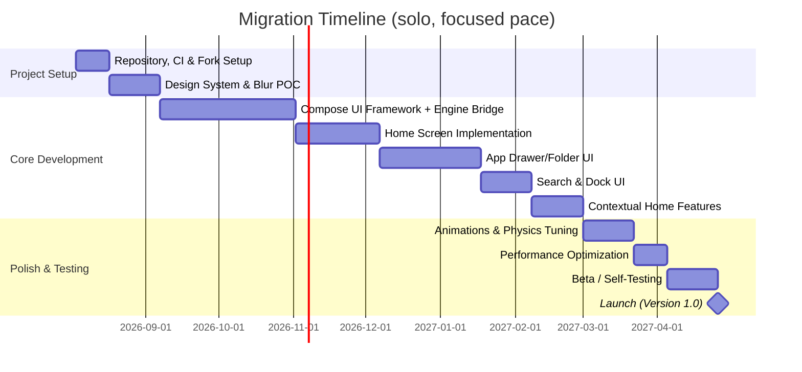

# Andromeda
*A redesigned Stario fork — Niagara- and iOS-inspired, by Omkar K.*

> **Revised August 2026.** Since the original draft: the source repo (albu-razvan/Stario) was archived by its owner in May 2026 — this plan now targets that frozen v2.16 codebase rather than the smaller, newer Yutila fork. Blur strategy updated to layer Haze (backdrop blur, now claims all-Android support) with Cloudy (liquid-glass accents, out of alpha as of 0.6.1). Timeline rebuilt for one focused developer starting August 2026, not a small team starting mid-2025. Compose Unstyled's module names checked against current docs. Added a section on Google's September 2026 Android developer-verification changes — which is the actual reason the original Stario project got archived. **Since then: project name finalized as Andromeda — see §10. The real v2.16 source has been reviewed against §1's reuse-mapping table (corrected below), and an initial Phase 1/2 scaffold exists — see the project's own README.md and CHANGELOG.md for what's actually built versus still planned.**

## Executive Summary
This report analyzes forking **Stario** — specifically `albu-razvan/Stario`, now archived and frozen at v2.16 — into **Andromeda**, a new Android launcher built with Jetpack **Compose Unstyled**, glassmorphic/liquid-glass design, and Niagara- and iOS-App-Library-inspired UX. Key preferences remain: no Material UI, frosted-glass blurs, SF Pro typography, springy physics, shared-element transitions, wallpaper-reactive theming, contextual home screen, grouped app-folder layouts (3 large + 4 mini icons), and a floating search/dock.

Decisions made since the original draft: **fork the archived original repo** rather than the smaller active Yutila fork, since a frozen codebase is a stable target rather than a moving one; **layer two blur libraries** — Haze for general backdrop blur (its changelog now claims support on every Android version, not just API 31+) and Cloudy for Apple-style liquid-glass accents on folders and the dock; and plan around **one focused developer** (~9 months, targeting late April 2027) rather than the original's 1–2 engineer team estimate. Compose Unstyled's module names from the original plan checked out against current docs; the one new requirement is a JDK 17 toolchain. Google's September 2026 Android developer-verification rollout doesn't block a personal-use build (ADB and its advanced-install flow remain available for unregistered apps), but it's worth knowing since it's the specific reason the original Stario developer archived the project.

## 1. Prioritized Feature List & Stario Components
We identify key features (priority from high to low) and whether Stario provides reusable logic or must be rewritten:

| **Feature**                               | **Priority** | **Stario Component**                              | **Reuse Strategy**                            |
|------------------------------------------|-------------|--------------------------------------------------|-----------------------------------------------|
| Minimal app drawer (vertical/one-handed)  | High        | Category & Drawer adapters, app indexing         | Reuse Stario's package listing logic and categories; replace XML with Compose UI |
| Alphabetic quick-scroll (Niagara-style)    | High        | (None directly)                                  | New implementation (may repurpose Stario's search indexed data) |
| Floating search/dock interface            | High        | SearchFragment, SearchBar, Feed logic            | Reimplement UI in Compose; reuse Stario's search engine and feed API if any |
| Context-aware home (smart shortcuts)      | Medium      | (None)                                          | New; leverage Android Slices/Shortcuts or heuristics |
| Wallpaper-reactive tinting               | Medium      | Theme.java, WallpaperAnimator                    | Extend Stario's wallpaper tint and parallax logic; apply to new UI elements |
| Grouped App Library folders (3+4 grid)    | High        | Folder.java, FolderAdapter, Folder list logic    | Reuse grouping logic; completely redesign UI grid in Compose |
| Glass/frosted blur backgrounds            | High        | (None; uses Material You in Stario)              | **Updated:** Haze for backdrop blur everywhere + Cloudy's liquid-glass effect for folder/dock accents (see §2) |
| Shared-element transitions (folders/apps) | Medium      | (None)                                          | New: use Compose Navigation's `sharedElement` or **Accompanist** transitions |
| Spring physics (scroll momentum, pop)      | Medium      | (None)                                          | New: Compose's `spring()` or **MotionLayout** can mimic physics |
| SF Pro–style typography                   | Medium      | (Uses custom fonts)                              | Already supported: replace Stario's font with SF Pro (Apple system font) |
| Weather/calendar widget                   | Low         | Weather widget, Calendar integration             | Reuse Stario's weather/calendar data; redesign widget view with Compose |
| Misc (RSS news, media controls)           | Low         | RSS, media players                               | Reuse business logic; drop or redesign UI as needed |
| Settings & customization                 | Low         | SettingsActivity                                 | Minimal reuse; update UI to Compose |
| **Legend:** High = must-have, Medium = important, Low = optional.                                                |             |                                                  |                                               |

*Update: the actual v2.16 source has since been reviewed (you uploaded it — see `reference/stario-source/` in the project scaffold). The original draft's class names hold up better than expected: `DrawerAdapter`, `Folder.java`, `FolderAdapter`, `Theme.java`, and — impressively — `WallpaperAnimator` all exist exactly as named (real paths: `sheet/drawer/DrawerAdapter.java`, `sheet/drawer/category/folder/`, `themes/Theme.java`, `ui/utils/animation/WallpaperAnimator.java`). `SearchFragment` exists too, at `sheet/drawer/search/SearchFragment.java`. Two corrections: "SettingsActivity" is actually `Settings.java` (`activities/settings/`), and "Categories" is really a trio — `Category.java`, `CategoryManager.java`, `CategoryMappings.java` (`apps/`). One thing the original draft couldn't have known: these classes aren't standalone. `Category` is clean and portable on its own, but the actual indexing orchestrator, `apps/ProfileApplicationManager.java` (507 lines), is tightly coupled to Stario's own `Application` subclass, its `SharedPreferences` wrapper, and `IconPackManager` — "reuse the engine" means untangling that coupling, not a copy-paste. See `core/engine/AppRepository.kt` in the scaffold for a decoupled reimplementation of the same `LauncherApps` + `registerCallback` approach, confirmed against the real class rather than guessed.*

Each high-priority item like the app drawer, search, and folders is mapped to Stario's existing backend, which can supply data and logic. The front-end of these features will be entirely rewritten in Compose Unstyled. Low-priority features (RSS, media, weather, settings) are good candidates to defer past v1.0 for a solo build — see §3.

## 2. Technical Feasibility

### Android API & Compose Libraries
Key technical requirements and platform limits — rechecked against current docs and changelogs:

- **Blur Effects:** `RenderEffect` (android.graphics) is still API 31+ only at the platform level — that hasn't changed. Both third-party libraries below have moved past where the original draft left them, though.
- **Haze (backdrop blur, primary choice):** its changelog now claims blur support across every Android version, not just 31+ (previously it fell back to a flat tint below 31). It's also mid-way through a 2.0 rework — alpha as of this writing — that splits blur into its own `haze-blur` module on top of a more general visual-effects system. Worth confirming the all-version blur claim has landed in a stable release (not just the 2.0 alpha) before locking a version for production; the mature 1.x line is the safer bet if 2.0 is still shaky by the time you get here.
- **Cloudy (liquid-glass accents):** no longer alpha — currently 0.6.1, Kotlin Multiplatform, GPU-accelerated with a CPU fallback for older devices. Since the original draft it's grown a genuine liquid-glass effect (Apple's current material name, not just generic blur), though full lens refraction specifically needs `RuntimeShader` (API 33+); below that it falls back to a tinted, edge-lit shape.
- **Compose Unstyled:** *Update: a real build attempt disproved this — see project CHANGELOG 0.1.2.* The modular coordinates (`composeunstyled-theming` etc.) don't actually resolve at the version confirmed for the library overall; that confirmation was for a different, single monolithic artifact (`com.composables:compose-unstyled`), and the two got conflated. The project now depends on that single confirmed artifact instead. Still needs a JDK 17 toolchain — check that against whatever JDK Stario's existing Gradle setup currently targets.
- **Accompanist Libraries:** navigation and UI utils (permissions, adaptive, navigation-animation). Google has been winding these down in favor of official Jetpack APIs for a while now — check for an official replacement before pulling any Accompanist module in fresh.
- **Coil:** `io.coil-kt:coil-compose` for image loading (app icons, avatars). Stable, standard choice; pull the current version at implementation time.
- **Lottie:** `com.airbnb.android:lottie-compose` for vector animations. Same — stable, grab the current version when you get there.
- **FlexibleBottomSheet (Skydoves):** for bottom sheets — same maintainer as Cloudy, worth checking both at once.
- **Spring animations:** Compose's built-in `spring()` AnimationSpec, plus MotionLayout where needed.
- **Wallpaper/Palette:** `WallpaperManager` for the current wallpaper — no extra permission needed for a launcher reading its own system wallpaper.

### Blur Approaches and API Table

| **Method**                    | **Android API Range** | **Implementation**                                  | **Pros/Cons**                                                  |
|-------------------------------|-----------------------|-----------------------------------------------------|---------------------------------------------------------------|
| `View.setRenderEffect`        | 31+                    | Native blur API (hardware-accelerated GPU)           | Fast, low-overhead — but the API 31 floor hasn't moved. |
| **Haze** — backdrop blur, primary | All Android per its current changelog (verify stable vs. 2.0-alpha before shipping) | `Modifier.hazeEffect { blurEffect }` | Multiplatform, purpose-built for backdrop blur; this plan uses it everywhere as the default. |
| **Cloudy** — liquid-glass, accent | All (GPU where available / CPU fallback); full lens refraction needs API 33+ | `Modifier.cloudy()` / background-blur mode | No longer alpha (0.6.1). Closest match to the iOS-era Apple look this plan is chasing — use sparingly (folder open, dock), not as the everywhere-blur. |
| **RenderScript/Canvas blur**  | Legacy (pre-31)       | Manual shaders, deprecated APIs                      | Skip — both Haze and Cloudy now cover what this used to be needed for. |
| **No blur (scrim)**          | All                   | Solid translucent overlay                             | Keep as the "Low graphics" settings-toggle fallback, not the default path. |
| **Glass materials (gradient+alpha)** | All          | Semi-transparent colors/gradients, no real blur       | Same idea as the scrim — cheap fallback, not primary. |

Given both libraries, the plan layers them: `Modifier.hazeEffect { blurEffect { blurRadius = 30.dp } }` for the backdrop on every screen, with Cloudy's liquid-glass modifier layered specifically on the folder card and dock — where the extra shine actually sells the iOS-inspired feel — rather than applied everywhere.

## 3. Migration Strategy & Timeline
We recommend an **incremental rewrite**, keeping Stario's core logic (app indexing, intents, backend) in place while rebuilding UI in Compose Unstyled. Since the original repo is archived, there's no upstream to track — the codebase is a fixed target for the fork, which is a genuine advantage for a solo build (no rebasing against someone else's ongoing changes).

This roadmap assumes **one focused developer**, starting August 2026, rather than the original's 1–2 person team starting mid-2025:



Each milestone, with solo-specific risk notes:
- **Repository, CI & Fork Setup** (2 weeks): Fork the archived repo, get the existing Java/Docker build working locally, then lay in the new Gradle modules and JDK 17 toolchain for the Compose side. *Risk:* Low and mechanical — but don't skip validating the existing Java build compiles cleanly before adding anything on top of it.
- **Design System & Blur POC** (3 weeks): SF Pro integration, Compose Unstyled theming setup, and a side-by-side Haze-vs-Cloudy test screen to nail down the split from §2 before it's baked into every screen. *Risk:* Scope creep — timebox the POC.
- **Compose UI Framework + Engine Bridge** (8 weeks): The biggest phase. Stand up `ui/` and `core/` modules, and expose Stario's existing Java engine (indexing, intents, wallpaper, widgets) through Kotlin-friendly interfaces the Compose layer can consume. *Risk:* This is where solo vs. team matters most — a team could split UI scaffolding and engine bridging in parallel; solo, it's sequential, hence the longer estimate than the original 45 days.
- **Home Screen UI** (5 weeks): Clock, widgets, search bar shell, wallpaper-reactive tinting. *Risk:* Blur/animation performance on real low-end hardware, not just an emulator — test early.
- **App Drawer & Folder UI** (6 weeks): Alphabetical Niagara-style list, the 3-large/4-mini App Library folder grid, shared-element transitions, spring physics. The single most complex UI phase. *Risk:* Gesture and animation edge cases — budget slack here before anywhere else.
- **Search & Dock UI** (3 weeks): Floating search/dock, wired to Stario's existing search/Kagi integration. *Risk:* Low, mostly wiring work.
- **Contextual Home Features** (3 weeks): Adaptive suggestions. *Risk:* Medium priority — first thing to cut or push to v1.1 if the schedule slips by this point.
- **Animations & Physics Tuning** (3 weeks): Pass over every spring/damping value now that real screens exist to tune against.
- **Performance Optimization** (2 weeks): Baseline profiles, recomposition/overdraw pass, and confirm the low-graphics fallback actually looks acceptable, not just functional.
- **Beta / Self-Testing** (3 weeks): No QA team, so this is dogfooding on your own daily driver plus whatever small group you can rope in (Discord, friends). *Risk:* Don't cut this phase to hit the date — solo projects that skip their own beta period are the ones that ship with a jarring first-week bug.
- **Launch v1.0**: ~April 26, 2027.

This lands in roughly the same total wall-clock time as the original's "8–9 months," which makes sense: removing a second person also removes coordination overhead, but individual phases (especially the engine bridge and folder UI) are sized up here to reflect that nothing parallelizes when it's just you. Low-priority items from §1 — RSS, media controls, a fully custom weather widget, deep settings — aren't in this Gantt at all; treat them as v1.1 backlog unless you'd rather fold them in now, which would push the date further out.

## 4. Architecture & Module Layout

We recommend a modular architecture separating engine logic from UI. For example:

```mermaid
graph LR
  subgraph Engine/Core
    A[App Indexing & Intents]
    B[PackageManager / Apps DB]
    C[Widget Host & Provider]
    D[Notification/Media Logic]
    A --> B
    C --> B
    D --> B
  end
  subgraph UI Modules
    E[HomeScreen UI (Compose)]
    F[AppDrawer & Folders UI]
    G[Search & Dock UI]
    H[Settings UI]
    E --> A
    E --> B
    E --> C
    F --> B
    G --> B
    G --> A
    H --> A
  end
  subgraph Shared
    I[Compose Unstyled Themes/Components]
    J[Accompanist/Coil/Lottie/etc.]
  end
  I --> E
  I --> F
  I --> G
  I --> H
  J --> E
  J --> F
  J --> G
  J --> H
```

In practice, the repo could have modules:
- **core/** – Kotlin (or Java/Kotlin) modules containing Stario's reusable engine (app loader, data models, system services).
- **ui/** – Compose modules (or a single app module) with screens implemented in Compose Unstyled.
- **data/** – If any local database (e.g. for app categories) or shared utilities.
- **widgets/** – Widget host code (may use existing Stario code).

For example, `settings.gradle.kts` could include:
```groovy
include(":core:engine", ":ui:home", ":ui:drawer", ":ui:search")
```
Each UI module depends on `core:engine` and the Compose libraries. This separation allows independent testing and reuse.

### Folder Layout (example)
- **core/engine/** – Stario's logic (app loading, intents, themes, wallpaper).
- **ui/home/** – Home screen composables, wallpaper blur, contextual widgets.
- **ui/drawer/** – App drawer and folders UI.
- **ui/search/** – Search/composer UI.
- **common/design/** – Design tokens, SF Pro font files, color schemes.
- **lib/** – Third-party libs (Gradle dependencies, no code here).

This part of the plan doesn't depend on which fork or blur library you pick, so it's unchanged from the original draft.

## 5. Recommended Libraries (Pros/Cons)

| **Library**             | **Gradle Coordinate**                         | **Use**                             | **Pros**                                                                                     | **Cons**                                                    |
|-------------------------|-----------------------------------------------|--------------------------------------|-----------------------------------------------------------------------------------------------|---------------------------------------------------------------|
| **Compose Unstyled**    | `com.composables:compose-unstyled` (single artifact — the modular per-component split guessed at earlier didn't actually resolve; see CHANGELOG 0.1.2) | Headless UI components (buttons, sheets) | No Material baggage, full styling control. | **Requires JDK 17.** Check against Stario's current toolchain before merging build configs. |
| **Haze** (Chris Banes) | `dev.chrisbanes.haze:haze` + `haze-blur` + `haze-materials` | Backdrop blur — primary, everywhere  | Changelog now claims blur on every Android version, not just 31+. Multiplatform, hardware-accelerated where available. | Mid-2.0 rework, currently alpha — verify stable-vs-alpha status of the all-version blur claim before shipping a version. |
| **Cloudy** (Skydoves)   | `com.github.skydoves:cloudy:0.6.1` (verify latest) | Liquid-glass accents — folders, dock | No longer alpha; 1.2k★ community. Liquid-glass shader matches the current Apple design language directly, GPU + CPU fallback. | Full lens refraction needs API 33+; older devices fall back to a simpler tinted/edge-lit shape. |
| **Accompanist**         | `com.google.accompanist:accompanist-XYZ` | Helpers (insets, permissions, nav-animation) | Official Google support for what's left. | Many modules are being sunset in favor of official Jetpack APIs — check for a replacement before adding fresh. |
| **Coil Compose**        | `io.coil-kt:coil-compose` | Image loading (icons, avatars) | Fast, Compose-native, standard choice. | None significant; pull current version at implementation time. |
| **Lottie Compose**      | `com.airbnb.android:lottie-compose` | Animations (splash, icons) | Easy JSON animation support, stable. | Native dependency, some APK size overhead. |
| **FlexibleBottomSheet (Skydoves)** | `com.github.skydoves:flexible-bottomsheet-material` (or `-material3`) | Bottom sheets | More flexible than Material3's; same maintainer as Cloudy. | Smaller community than official alternatives. |
| **Compose Navigation**  | `androidx.navigation:navigation-compose` | In-app navigation | Official Google library, back stack + transitions. | Shared-element transitions still need extra setup. |
| **Accompanist Navigation Animation** | `com.google.accompanist:accompanist-navigation-animation` | Animated nav transitions | Enables experimental transition APIs. | Migrate to official Compose Navigation animation support if/when it's stable by the time you build this. |

*Note: Compose Unstyled, Haze, and Cloudy were re-verified against current docs/changelogs for this refresh. Accompanist, Coil, Lottie, FlexibleBottomSheet, and Compose Navigation weren't individually re-checked this round — pull current version numbers at implementation time rather than trusting any number pinned here, since these all update independently.*

## 6. App Library Folder UI (Sample Implementation)

Below is a conceptual sketch of how the **App Library folder** (3 large + 4 mini icons) can be implemented in Compose Unstyled. This illustrates the Haze backdrop blur layer; per §2, Cloudy's liquid-glass modifier would sit on top of the folder `Card` itself (not the backdrop) when this moves from sketch to real implementation.

```kotlin
// Pseudocode in Compose Unstyled style
@Composable
fun AppFolderView(folder: AppFolder, onClose: () -> Unit) {
    // State for animation
    val openTransition = remember { MutableTransitionState(false) }
    openTransition.targetState = true

    // Background blur using Haze (backdrop, all Android versions per its current changelog)
    Box(modifier = Modifier
        .fillMaxSize()
        .background(Color.Black.copy(alpha = 0.4f))
        .hazeEffect(
            hazeState = rememberHazeState(),
            blurEffect = BlurEffect(
                blurRadius = 30.dp,
                colorEffects = listOf(HazeColorEffect.tint(Color.White.copy(alpha = 0.2f)))
            )
        )
        .clickable { onClose() } // tap background to close
    ) {
        // Folder content card (shared element) — Cloudy liquid-glass modifier goes here in the real build
        Card(
            modifier = Modifier
                .fillMaxWidth(0.9f)
                .align(Alignment.Center)
                .sharedElement("folder_${folder.id}") // Accompanist or custom shared element
        ) {
            Column {
                Text(folder.title, style = /* SF Pro heading */)
                Spacer(modifier = Modifier.height(16.dp))
                // 3x4 grid: 1 large per row + 2 small per row in first 3 rows, last row 4 mini icons
                // Simplify: show 7 icons: first 3 big, next 4 small
                LazyVerticalGrid(
                    cells = GridCells.Fixed(3),
                    modifier = Modifier.padding(8.dp),
                    content = {
                        itemsIndexed(folder.apps) { index, app ->
                            val isLarge = (index < 3)
                            val size = if (isLarge) 72.dp else 40.dp
                            Image(
                                painter = rememberAsyncImagePainter(app.icon),
                                contentDescription = app.name,
                                modifier = Modifier
                                    .size(size)
                                    .graphicsLayer {
                                        val scale by transition.animateFloat(
                                            transitionSpec = { spring(dampingRatio = Spring.DampingRatioLowBouncy) },
                                            label = ""
                                        ) { state ->
                                            if (state) 1f else 0f
                                        }
                                        scaleX = scale; scaleY = scale
                                    }
                                    .clickable { /* launch app */ }
                            )
                            if ((index + 1) % 3 == 0) {
                                Spacer(modifier = Modifier.height(24.dp))
                            }
                        }
                    }
                )
            }
        }
    }
}
```

**Explanation:** We overlay a full-screen Box with a translucent scrim and a Haze blur modifier (`hazeEffect`) to create the frosted-glass backdrop. Inside, we show a Card (centered, width 90% of screen) as a shared-element (identified by a key like `"folder_123"`). The grid is implemented with `LazyVerticalGrid` (3 columns): the first three items as "large" icons (72dp), the next four as smaller (40dp), each with a spring-based scale-in animation. The typography would use SF Pro; accent tint drawn from the wallpaper. This is still illustrative pseudocode — worth revisiting once we're actually building, per your earlier note.

## 7. Testing, Performance & Fallbacks

- **Testing Strategy:** Use Jetpack Compose's testing framework. Write unit tests for view-model logic. Use **Compose UI tests** (`ComposeTestRule`) for UI flows (folder open, search, drag&drop). Create integration tests for launch-intent flows. Employ **screenshot tests** for critical screens in various states. For performance, add Android **Baseline Profiles** and measure jank with Macrobenchmark as per Android docs.
- **Performance Considerations:** Profile for overdraw and recomposition. Cache expensive computations with `remember`, supply stable keys in lazy lists, avoid unnecessary state reads. Use Release builds (R8, full optimization) for performance testing. Limit blur radius on low-end devices. Provide a "Low graphics" setting that drops both Haze and Cloudy down to the plain scrim fallback from §2's table.
- **Low-End Device Fallbacks:** Since both minSdk-eligible forks require Android 10+ (SDK 29) already, the pre-31 gap to worry about is narrower than the original draft assumed (just API 29–30, not down to API 27). Test the "Low graphics" toggle explicitly, not just the happy path — it's now covering two libraries instead of one. Simplify animations (`spring(dampingRatio=MediumBouncy)` rather than `LowBouncy`) on slow devices. Always test on a real low-end/older device, not just an emulator.
- **Performance Citations:** Compose performance docs note that well-optimized Compose can match Views for jank; use that guidance (baseline profiles, release mode) to keep things smooth.

## 8. Security, Privacy & Permissions

- **Launcher & Widgets:** A home app doesn't need special permissions to act as the default launcher. Hosting App Widgets uses the `AppWidgetHost` API, available to launcher apps without the (system-reserved) `BIND_APPWIDGET` permission — the system mediates binding through a user-confirmation flow instead.
- **Wallpaper Access:** Reading the current wallpaper via `WallpaperManager.getDrawable()` doesn't require a runtime permission for a launcher reading the system wallpaper. Letting the user set wallpapers from external images would need `READ_MEDIA_IMAGES` (Android 13+) or `READ_EXTERNAL_STORAGE` on older versions.
- **Usage/Notifications:** Context-aware suggestions using usage stats (`PACKAGE_USAGE_STATS`) or notifications (`ACCESS_NOTIFICATION_POLICY`) need explicit user opt-in. Avoid collecting user data beyond app listings.
- **Network:** Online search (e.g. Kagi, which Stario already integrates) needs `INTERNET` and shouldn't log queries. Same for weather/RSS.
- **Accessibility:** Any one-handed-gesture or auto-scroll features built on Accessibility Services need explicit user enablement and a clear explanation of why.
- **Privacy:** No personal data collection beyond system-provided app metadata. Let users opt out of any suggestive/contextual features.

### Distribution & Android's September 2026 Developer Verification
Not in the original draft, since it postdates it: Google is rolling out developer verification for sideloaded apps, with enforcement starting **September 30, 2026** in four countries (Brazil, Indonesia, Singapore, Thailand) and expanding globally in 2027. For a launcher you build and install on your own device, this doesn't meaningfully change anything — ADB installs and the "advanced flow" for unregistered apps stay available regardless of registration status. If this ever grows beyond your own phone, Google's free hobbyist tier (up to 20 devices, no ID or fee) comfortably covers a small personal/community distribution. Worth knowing regardless: this is the specific policy the original Stario developer cited when archiving the project.

One more practical note: the original repo is **GPL-3.0** licensed, so a public fork or redistribution needs to stay GPL-3.0 and open-source under its terms. Not a blocker for a personal build, just worth a proper read of the license if distribution plans ever firm up — this isn't legal advice.

## 9. UX Design References

- **Niagara Launcher** – One-handed, list-based UI. See the official site and reviews for visual style.
- **iOS App Library / Home** – Apple's Human Interface Guidelines specify SF Pro as the system font; the App Library (iOS 14+) groups apps into auto-organized folders. See Apple's [HIG](https://developer.apple.com/design/human-interface-guidelines) and WWDC's "Designing Fluid Interfaces" for springs and shared-element transitions.
- **Liquid Glass (Apple, 2025–26 design language)** – Cloudy's liquid-glass effect (§2) is explicitly modeled on this. Worth looking at Apple's own current material examples directly, not just older "glassmorphism" writeups, since this is the more specific, current reference point for what you're actually building toward.
- **Glassmorphism** – Broader translucency/depth style, still a useful general reference alongside the more specific Liquid Glass one above.
- **Jetpack Compose Community** – Compose Unstyled docs for architectural patterns; the [official performance guide](https://developer.android.com/develop/ui/compose/performance); Haze and Cloudy READMEs for current API details (check these fresh — both libraries move fast).
- **WWDC/Apple Design** – Sessions on SwiftUI animation and materials for fluid-transition insight. [Apple Fonts](https://developer.apple.com/fonts/) confirms SF Pro as the standard UI font.
- **Android HIG and Patterns** – No official one-handed launcher spec, but Material You's motion spec and adaptive-icon guidance still apply. Accompanist's docs remain a reference for shared-element navigation.

**Sources:** Niagara's official site and reviews, Apple's Human Interface Guidelines, Android/Compose documentation, and current library docs/changelogs (Haze, Cloudy, Compose Unstyled) as re-verified for this refresh, plus GitHub for Stario's own repo status.

## 10. Branding, Credits & Identity

**Project name:** Andromeda
**Package / applicationId:** `dev.omkardile.andromeda`
**Author:** Omkar K. — alias "omik // whysoserious"

### Attribution
GPL-3.0 requires keeping the license and copyright notices intact; crediting the original author by name is standard open-source practice on top of that — and it's what Yutila's fork already does. Suggested line for `LICENSE`/`NOTICE` and the README:

> Andromeda is a fork of [Stario](https://github.com/albu-razvan/Stario) (archived May 2026), originally created by Răzvan Albu. Original concept and engine: Răzvan Albu. Redesign, UI rewrite, and continued development: Omkar K.

### About-screen draft
```
Andromeda
Redesigned by Omkar K.

A home screen built the way software should feel — refined,
fluid, and considered down to the corner radius. Andromeda
started as a fork of Stario and became a full rebuild: new UI,
new physics, new glass.

Design & development
Omkar K. ("omik // whysoserious")
omkardile.is-a.dev · github.com/OmKardile

Original Stario concept & engine
Răzvan Albu · github.com/albu-razvan/Stario · GPL-3.0
```

### README opener draft
```markdown
# Andromeda

A ground-up UI rebuild of [Stario](https://github.com/albu-razvan/Stario) —
glassmorphic, Niagara- and iOS-App-Library-inspired, built on Jetpack
Compose Unstyled.

Design-first, one person, no Material You in sight.

**Built by** [Omkar K.](https://omkardile.is-a.dev) ("omik // whysoserious")
— [more of my work](https://mylinks-omkardile.vercel.app/) ·
[GitHub](https://github.com/OmKardile)

> Forked from the archived [Stario](https://github.com/albu-razvan/Stario)
> (GPL-3.0), originally by Răzvan Albu. Andromeda keeps the engine,
> rebuilds everything else.
```

### Tagline, pick one (or none)
- "The nearest galaxy, now the closest thing to home."
- "A home screen with room to breathe."
- "Crafted, not assembled." — your own words, turned into the pitch.

None of this is locked — it's a starting draft using the copy style from your portfolio/links pages. Easy to tighten once there's an actual app icon and screenshots to write around.
